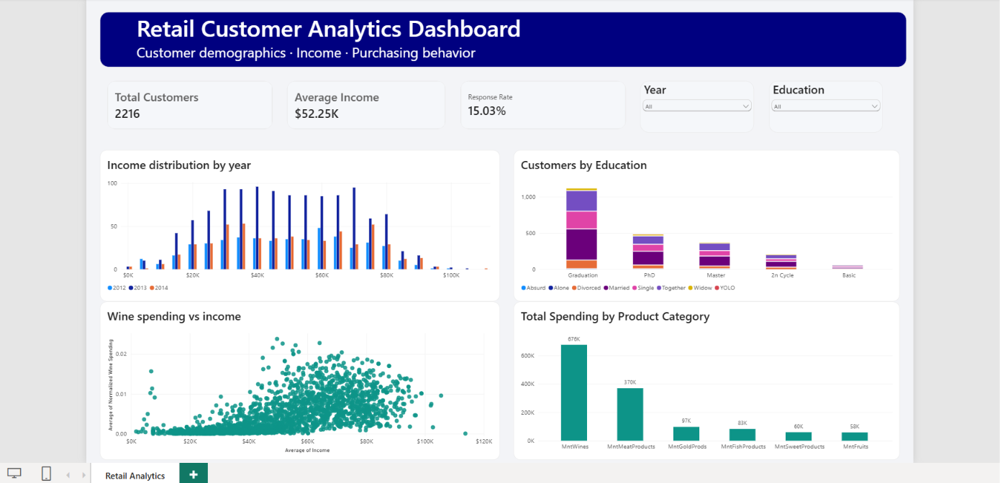
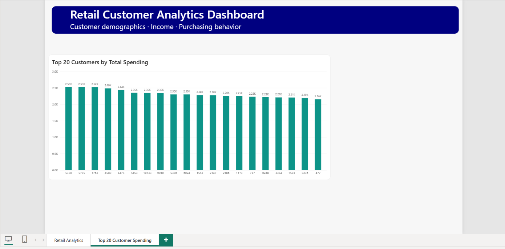

# Retail Analytics: Predicting Customer Purchase Behavior

## Project Overview

This project analyzes customer demographics, purchasing patterns, and marketing campaign responses to support more targeted retail marketing decisions. Using **Python, MySQL, Excel, and Power BI**, it combines data cleaning, exploratory analysis, SQL reporting, and interactive visualizations. The current scope is **descriptive and exploratory**, not predictive modeling.

## Tools

- **Python:** Data cleaning, validation, and exploratory data analysis (EDA)
- **MySQL:** Data storage, quality checks, and analytical queries
- **Excel:** Descriptive statistics, PivotTables, and charts
- **Power BI:** Interactive customer and spending dashboards

## Dataset and Key Metrics

The marketing campaign dataset contains **2,240 customer records**. Removing 24 records with missing income values produced a cleaned dataset of **2,216 customers**.

| Metric | Result |
|---|---:|
| Cleaned customers | 2,216 |
| Average customer income | $52,247.25 |
| Positive campaign responses | 333 |
| Campaign response rate | 15.03% |

## Data Cleaning and Validation

- Checked missing values, duplicate customer IDs, and data types; removed 24 records with missing income.
- Created an `Age` feature from customer birth years.
- Formatted `Dt_Customer` in Excel as **Day-Month-Year (`dd/mm/yyyy`)** for consistent date display.
- Verified **2,216 unique customer IDs**, **no remaining missing values**, and **no duplicate IDs**; compared Python and MySQL validation results.

## Analysis Highlights

- **Excel:** Summary statistics, enrollment trends by year, income boxplot, age histogram, and campaign response comparisons by education and marital status.
- **SQL:** Customer demographics, average income, spending across six product categories, campaign acceptance and response counts, household composition, and website visits by age group.
- **Python:** Distributions, outliers, demographic and income relationships with campaign response, and correlation analysis.
- **Power BI:** Income distribution, education and marital status, normalized wine spending, product-category spending, and **Top 20 Customers by Total Spending**. Year and Education slicers support interactive exploration.

## Power BI Dashboard

### Main Dashboard

### Top 20 Customers by Total Spending

## Business Recommendations

- **Target customer segments:** Use age, education, marital status, and income patterns to guide campaign targeting.
- **Personalize promotions:** Use product-category spending to develop more relevant offers.
- **Evaluate engagement:** Compare campaign acceptance and response patterns when planning future promotions.
- **Support retention:** Explore loyalty initiatives for high-spending customers.

**Future improvements:** Train and evaluate a campaign-response classification model, and incorporate campaign costs and attributable revenue to calculate promotional ROI. Neither is implemented in the current project.

## Repository Contents

| Folder | Contents |
|---|---|
| `data/` | Original and cleaned customer datasets |
| `excel/` | Excel analysis workbook |
| `sql/` | MySQL analysis script |
| `python/` | Jupyter notebook for cleaning and EDA |
| `power bi/` | Power BI dashboard (`.pbix`) |
| `screenshots/` | Dashboard preview images |

## How to Explore the Project

1. **Python:** Open the notebook in `python/`, install any required libraries (including pandas, NumPy, Matplotlib, and Seaborn), adjust the CSV path if necessary, and run the cells in order.
2. **MySQL:** Open the script in `sql/` with MySQL Workbench. Use the **cleaned CSV** from `data/`, check `SHOW VARIABLES LIKE 'secure_file_priv';`, update the `LOAD DATA INFILE` path, and run the setup, import, and queries on a new database.
3. **Excel:** Open the workbook in `excel/` to review statistics, PivotTables, and charts.
4. **Power BI:** Open the `.pbix` file in `power bi/` using Power BI Desktop. If necessary, update the data source through **Transform data → Data source settings**.

**Reproducibility notes:** File paths may need updating on another computer. SQL-derived age values depend on the calendar year in which the script is run.
